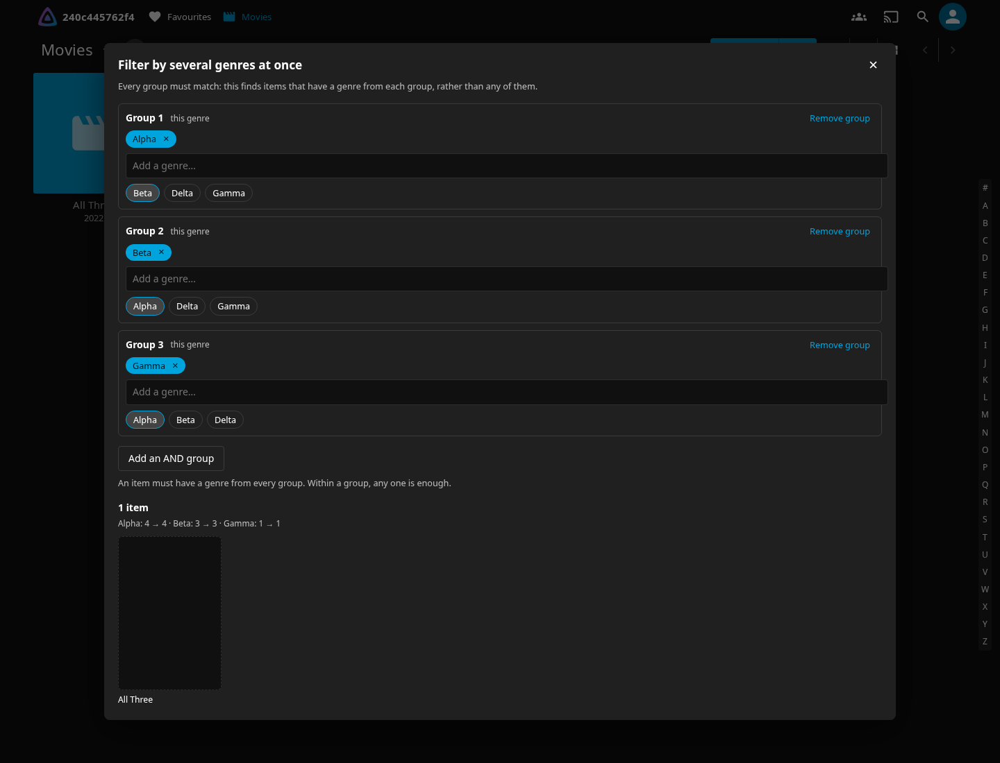
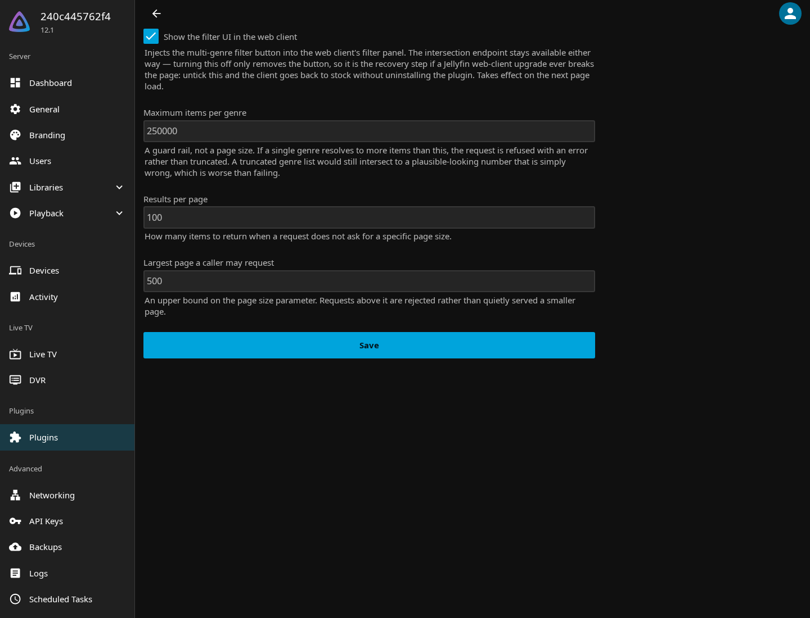

# Intersect — filter your Jellyfin library by multiple genres at once

**Jellyfin's filter can only give you Action *or* Comedy. This plugin gives you Action *and* Comedy.**

A Jellyfin plugin that lets you filter a library by intersecting multiple values from the same
category — **movies that are both Action and Comedy**, not movies that are either. Pick any
number of genres, in any number of groups, and browse only the items that carry all of them.



Three groups: `Alpha` AND `Beta` AND `Gamma`. Stock Jellyfin cannot express this at all — its
ceiling is two groups. The line under the results (`Alpha: 4 → 4 · Beta: 3 → 3 · Gamma: 1 → 1`)
shows each criterion closing in, so you can see which one did the narrowing.

---

## Why this needs a plugin

Jellyfin's server has always been able to do the hard part. `/Items` composes separate
parameters with **AND** and values inside one parameter with **OR**, so
`genres=Action&genreIds=<Comedy>` is a true intersection. Measured on a 5,614-item library:

| Query | Result | Meaning |
|---|---|---|
| `genres=Action` | 260 | |
| `genres=Comedy` | 223 | |
| `genres=Action\|Comedy` | 456 | union — **OR** |
| `genres=Action&genreIds=Comedy` | **27** | intersection — **AND** |

`260 + 223 − 27 = 456`. The arithmetic closes exactly, so the server is doing the right thing.

**What's missing is a way to ask.** There are exactly two genre parameters, so the server can
AND at most **two** groups — `(A or B) and (C or D)` — and the stock web client wires its Genres
accordion to only one of them, which means the UI can only ever produce a union. That
limitation has been known since at least 2021: [jellyfin/jellyfin#4752](https://github.com/jellyfin/jellyfin/issues/4752)
was closed with a maintainer replying *"Currently not possible… Currently it's an OR
expression."*

This plugin removes the two-group ceiling. It does not touch how Jellyfin matches, ranks or
tokenizes anything — it is set intersection over metadata you already have.

---

## Install

> **Status: source-only.** There is no packaged release published yet, so installation today
> means building the DLL. Once a release is cut, the plugin-repository route below becomes the
> normal one.

**Requirements:** Jellyfin **12.1.0** exactly. See [Compatibility](#compatibility).

### From source

```bash
git clone https://github.com/G3n1e/jellyfin-plugin-intersect-filter
cd jellyfin-plugin-intersect-filter
dotnet build src/BetterJellyfinFiltering -c Release
```

Copy `src/BetterJellyfinFiltering/bin/Release/net10.0/Jellyfin.Plugin.BetterFiltering.dll` and
`src/BetterJellyfinFiltering/meta.json` into your server's plugin folder:

```
<config>/plugins/BetterJellyfinFiltering/
```

`dotnet` must be able to target `net10.0`. Then **restart Jellyfin** — plugins load only at
startup.

### From a plugin repository (once published)

Dashboard → Plugins → Repositories → add the manifest URL, then install **Intersect —
Multi-Criteria Filtering** from the catalogue.

---

## Use

1. Open a library and click the **filter** icon in the toolbar.
2. Click **Filter by several genres…** at the top of the filter panel.
3. Type or pick a genre for **Group 1**.
4. Click **Add an AND group** and add another. Repeat for as many as you need.
5. Results update live. Click any result to open its normal details page.

**The rule is one sentence:** an item must have a genre from *every* group; within a group, any
one is enough. `Group 1: Action or Comedy` + `Group 2: Heist` means *"Action-or-Comedy, and
Heist"*.

Inside a group either separator works the way you'd expect:

| You want | How to express it |
|---|---|
| Action **and** Comedy | Group 1: `Action`, Group 2: `Comedy` |
| Action **or** Comedy | one group: `Action` then `Comedy` in the same group |
| Action or Comedy, **and** Heist | Group 1: `Action`, `Comedy` · Group 2: `Heist` |
| Action **and** Comedy **and** Heist | three groups, one genre each |

The genre box accepts typing as well as picking. Press <kbd>Enter</kbd> to add what you typed,
or <kbd>↓</kbd> to choose from the matches first. A genre the library does not list is still
accepted — it gets a dashed outline and a tooltip saying so, rather than being silently dropped
or passed off as verified. That matters because the option list comes from
`Items/Filters`, which is scoped to the view you are browsing and is **not** a complete
inventory of every genre in the library.

If nothing matches, the criteria line still appears and names the criterion that emptied the
result — a typo shows up as `Zzz Not A Genre: 0 → 0` rather than an unexplained empty page.

### Settings

Dashboard → Plugins → **Intersect**. Changes take effect on the next page load; no restart.



| Setting | Default | What it does |
|---|---|---|
| Show the filter UI in the web client | on | **The recovery switch.** Turns the injection off and leaves a stock web client, without uninstalling the plugin. See [If it breaks](#if-it-breaks-after-a-jellyfin-upgrade). |
| Maximum items per genre | 250000 | A guard rail, not a page size. A genre resolving to more items than this is **refused with an error**, never truncated — see below. |
| Results per page | 100 | Page size when a request does not ask for one. |
| Largest page a caller may request | 500 | Upper bound on `limit`. Larger requests are rejected. |

**Why the cap refuses instead of truncating.** Intersecting a *page* is not intersecting a
*set*. Resolving `Alpha AND Beta` with `limit=2` returns two items where the truth is three:
one falls outside the page and the answer is quietly short. It looks exactly like a normal
result, with no error. So the plugin reads criteria whole, refuses an oversized criterion
outright, and reports an exact total.

---

## HTTP API

The intersection is available directly, independent of the web client.

```
GET /BetterJellyfinFiltering/Intersect?groups=Action&groups=Comedy
```

Repeat `groups` once per AND-group. Within one group, separate names with `|` to OR them.

```
?groups=Action|Comedy&groups=Heist          →  (Action OR Comedy) AND Heist
?groups=Action&groups=Comedy&groups=Heist   →  Action AND Comedy AND Heist
```

| Parameter | Notes |
|---|---|
| `groups` | Repeatable. `\|` ORs within a group. Omit entirely and you get the unfiltered library **plus an explicit warning** telling you no criterion was applied. |
| `parentId` | Library or folder to search. Omit for the whole library. |
| `recursive` | Defaults to `true`. |
| `includeItemTypes`, `fields`, `sortBy`, `sortOrder`, `startIndex`, `limit` | As on `/Items`. |
| `userId` | For **API-key** callers only. A signed-in caller is always scoped to itself and may not name another user. |

Authentication is the standard header for this server version:

```bash
curl -H 'Authorization: MediaBrowser Token="YOUR_API_KEY"' \
  'http://your-server:8096/BetterJellyfinFiltering/Intersect?groups=Action&groups=Comedy'
```

> `X-Emby-Token` is **rejected** (401) by Jellyfin 12.1. Use `Authorization: MediaBrowser
> Token="…"`.

**Malformed input is always an error, never a quietly dropped filter.** A bad request returns
`400` with an `Errors` array (a group with a doubled or trailing `|`, an unknown
`includeItemTypes`, a `limit` out of range). `403` means a signed-in caller named someone
else's `userId`. `422` means a criterion exceeded the configured cap.

This is deliberate, and it is the one behaviour worth understanding about this plugin. Jellyfin's
own `genreIds` parameter documents `|` as its separator but binds on commas only, so
`genreIds=A|B` fails to parse as a GUID, is logged at *Debug*, and the **entire filter is
silently discarded** — you get an unfiltered page and no error. This plugin exists to make a
filter say what it means, so it never degrades a malformed filter into an unfiltered query.

---

## Compatibility

| Jellyfin | Plugin | Status |
|---|---|---|
| **12.1.0** | 0.1.0.0 | **Supported.** `targetAbi` 12.1.0.0, verified against a live 12.1.0 server. |
| 12.0.x | — | Untested. The ABI pins to 12.1.0.0; expect Jellyfin to refuse it. |
| 10.x, 11.x | — | **Not supported.** Different plugin ABI, and the client-side facts below were verified against the v12.1 web client only. |

Known issues are listed in [CHANGELOG.md](CHANGELOG.md).

### This works via an unofficial hook

The plugin UI is injected into the web client by rewriting `/web/index.html` as it is served.
Jellyfin does not provide a supported hook for this: [jellyfin#9095](https://github.com/jellyfin/jellyfin/pull/9095),
which would have added one, was **closed unmerged**, with the project stating it *"doesn't
support web client modifications."* `jellyfin-web`'s `index.html` is a `<div id="reactRoot">`
and nothing else, so every injection mechanism has to string-match `</body>`. That is the
shared fragility, and it is the reason the compatibility table above is narrow on purpose.

**What this means for you:** the server API is stable, the *web client* is the surface that can
break. A Jellyfin upgrade that changes the shell's shape may leave the button missing or the
dialog broken. The intersection endpoint keeps working regardless.

#### If it breaks after a Jellyfin upgrade

1. Dashboard → Plugins → **Intersect** → untick **Show the filter UI in the web client** → Save.
   Your web client is stock again on the next page load, with no restart and no uninstall.
2. The `/BetterJellyfinFiltering/Intersect` endpoint stays live, so anything calling the API
   directly keeps working.
3. Check [CHANGELOG.md](CHANGELOG.md) for a version that supports your release, or open an issue
   with your Jellyfin version and web-client build (the issue template asks for both).

To recover you never have to edit XML or delete files by hand.

---

## FAQ

**How is this different from Auto Collections or SmartLists?**
Those are collection generators: both already compute true intersections — SmartLists'
`AndNode.Evaluate` is literally `Left && Right` — but they **materialise the result as a
collection** that you then browse. This plugin filters **live in the browse view**. You stay in
your library, change a criterion, and the grid updates. That live-browse gap is the actual
missing feature, and it is why this is a plugin rather than a rule file.

**Does this work on Jellyfin 10.x or 11.x?**
No. It targets 12.1.0 (`targetAbi` 12.1.0.0). The plugin ABI differs, and the web-client
findings were verified against the v12.1 client only.

**Will this be merged into Jellyfin?**
No, and it isn't trying to be. #4752 is closed and #9095 was closed unmerged.

**Does it change search, ranking, or text matching?**
No. It is set intersection over existing genre metadata.

**Why can't I just use the stock filter twice?**
Because the stock filter has one genre control and it ORs. Selecting Action and Comedy there
gives you everything that is either one — 456 items in the measurement above, against the 27
that are genuinely both.

**I typed a genre and it got a dashed outline. Is that an error?**
No — it means that genre is not in the list this view offers. The filter still runs. If it
matches nothing you'll see it named in the criteria line.

---

## Comparison

| | Live filtering in the browse view | True AND across >2 groups | Materialises a collection | Setup |
|---|---|---|---|---|
| **Intersect** (this plugin) | **Yes** | **Yes, unlimited** | No | Install plugin, pick genres |
| Stock Jellyfin filter | Yes | No — 2 groups max, and the UI exposes only OR | No | — |
| [SmartLists](https://github.com/jyourstone/jellyfin-smartlists-plugin) | No | Yes | Yes — a playlist | Write rules, run scheduled task |
| [Auto Collections](https://github.com/KeksBombe/jellyfin-plugin-auto-collections) | No | Yes | Yes — a collection | Write rules, run scheduled task |
| Jellyfin Enhanced — *Granular Filtering* | Yes | n/a | No | Different thing entirely: **visibility** control, not a filter |

---

## Non-goals

Stated plainly so nobody has to guess:

- **Not a search-relevance plugin.** It does not change text matching, ranking, typo tolerance or
  tokenization. It is set intersection over metadata you already have. Scope creep here is the
  main risk to this project.
- **Not a collection generator.** See the comparison above.
- **Not a content-hiding tool.** Jellyfin Enhanced's Granular Filtering is visibility control —
  a different feature that answers a different question.
- **Not an upstream contribution.** See the FAQ.

---

## Development

Everything in this repo is reproducible. `docs/FINDINGS.md` is the research record: every claim
about Jellyfin behaviour carries either a `file:line` citation at a pinned revision or a
measurement from a script in `prototype/`. Nothing is from memory, and things that could not be
verified are labelled as such.

```
src/BetterJellyfinFiltering/     the plugin
  Controllers/                   the intersection endpoint
  Services/                      the intersection itself
  Client/                        the injected web-client UI
  Configuration/                 the settings page
tests/                           53 unit tests
prototype/                       live-server harnesses + fixture generation
docs/FINDINGS.md                 the research record
docs/ARCHITECTURE.md             for maintainers: mechanism, hazards, upgrade playbook
```

### Running the harnesses

The harnesses run against a throwaway Jellyfin on **:8097**, built from generated fixtures with
exact, known genre overlaps. Ground truth is re-derived from the stock API at run time rather
than hardcoded, so a stale expectation cannot let a wrong answer pass.

```bash
cd prototype
bash make-fixtures.sh          # generate the fixture library
docker compose up -d           # throwaway Jellyfin on :8097
python3 setup-server.py        # wizard, admin user, library, scan
python3 verify-fixtures.py     # the delimiter trap, asserted permanently
bash deploy-plugin.sh          # build, install, restart, confirm it loaded
python3 server-controller-test.py   # 42 checks against the live endpoint
python3 client-test.py              # 45 checks driving the real web client
python3 config-page-test.py         # 14 checks driving the real settings page
```

```bash
dotnet test tests/BetterJellyfinFiltering.Tests    # 53 unit tests
```

`prototype/deploy-plugin.sh` targets the throwaway instance only. See
[docs/ARCHITECTURE.md](docs/ARCHITECTURE.md) for how the pieces fit and what to check on each
Jellyfin release.

## License

GPL-3.0 — see [LICENSE](LICENSE). Conventional in this ecosystem and compatible with the
Jellyfin code this plugin is written against.
